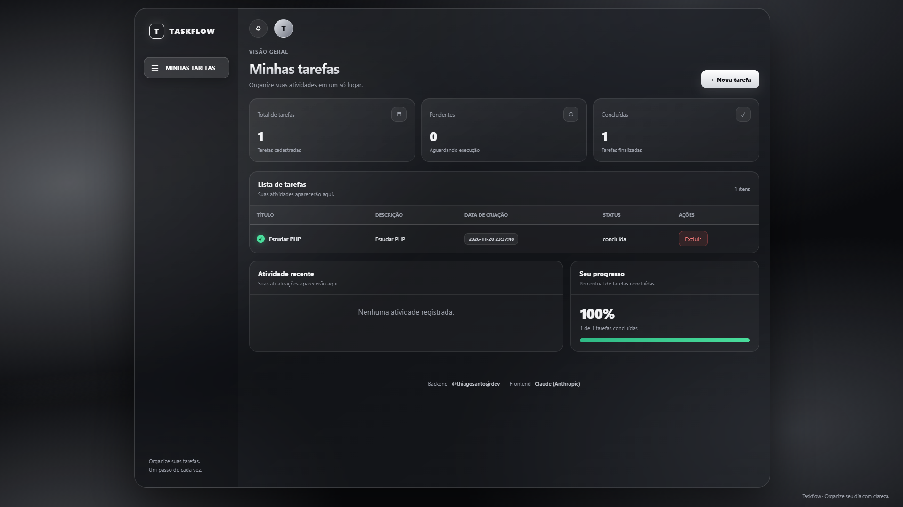

# Task Manager

🇺🇸 English | [🇧🇷 Português](README.pt-BR.md)

A simple, single-user task manager built with **PHP**, **PDO** and **MySQL**. Create tasks, mark them as done, delete them and follow your progress through a dark, fully responsive interface that works on desktop and mobile.



## Features

- Create tasks with a title and a description
- Mark tasks as completed (and undo it)
- Delete tasks, with a confirmation prompt
- Dashboard with total, pending and completed counters
- Progress bar showing the percentage of completed tasks
- Success and error feedback messages
- Responsive layout: sidebar on desktop, bottom navigation bar and card-style list on mobile
- Database access through PDO prepared statements; all output is HTML-escaped

## Tech stack

- PHP 8.1+
- MySQL / MariaDB (PDO)
- HTML, CSS and vanilla JavaScript (no frameworks or build step)

## Project structure

```
task-manager/
├── config/
│   ├── config.php        # Loads the .env-style configuration file
│   └── Database.php      # PDO connection
├── database/
│   └── schema.sql        # Database and table creation script
├── public/
│   ├── index.php         # Main page and request handling
│   ├── create.php        # create_task()
│   ├── delete.php        # delete_task()
│   ├── functions.php     # returnTasks(), searchByID(), changeStatus()
│   └── style.css
├── views/
│   ├── header.php
│   └── footer.php
├── task-manager.env.example
└── README.md
```

## Requirements

- PHP 8.1 or higher with the `pdo_mysql` extension
- MySQL or MariaDB
- A local web server (Apache via XAMPP/WAMP/MAMP, for example) or PHP's built-in server

## Installation

### 1. Clone the repository

```bash
git clone https://github.com/<your-username>/task-manager.git
cd task-manager
```

### 2. Create the database

Run the script in `database/schema.sql` using the MySQL client or phpMyAdmin:

```bash
mysql -u <your_mysql_user> -p < database/schema.sql
```

### 3. Create the configuration file

The database credentials are read from a `task-manager.env` file that is **not** stored in the repository. Copy the example and fill in your values:

```bash
cp task-manager.env.example task-manager.env
```

```ini
DB_HOST="localhost"
DB_NAME="task_manager"
DB_USER="your_mysql_user"
DB_PASS="your_mysql_password"
```

By default, `config/config.php` looks for the file at:

```php
dirname(__DIR__, 6) . '/config/task-manager.env'
```

That means: go **six directory levels up** from the project's `config/` folder, then open `config/task-manager.env` there. Place your file in that location, or change the second argument of `dirname()` (or the whole path) to wherever you prefer to keep it.

### 4. Run the application

**Option A – Apache (XAMPP, WAMP, MAMP):** copy the project into the server's web root (for example `htdocs/`) and open:

```
http://localhost/task-manager/public/
```

**Option B – PHP built-in server:**

```bash
php -S localhost:8000 -t public
```

Then open `http://localhost:8000`.

## Usage

1. Click **Nova tarefa** to create a task (title and description).
2. Click the circle next to a task to mark it as completed; click it again to set it back to pending.
3. Click **Excluir** to delete a task.
4. Follow the counters and the progress bar at the top and bottom of the page.

## Notes

- The interface is written in Brazilian Portuguese.
- Task titles are limited to 20 characters and must be unique.
- This project has **no login or user accounts**. It was designed for personal use by a single person, so do not expose it publicly without adding authentication.
- Never commit your `task-manager.env` file. It is already listed in `.gitignore`.

## Credits

- **Backend:** [@thiagosantosjrdev](https://github.com/thiagosantosjrdev)
- **Frontend:** [Claude](https://claude.ai) (Anthropic)