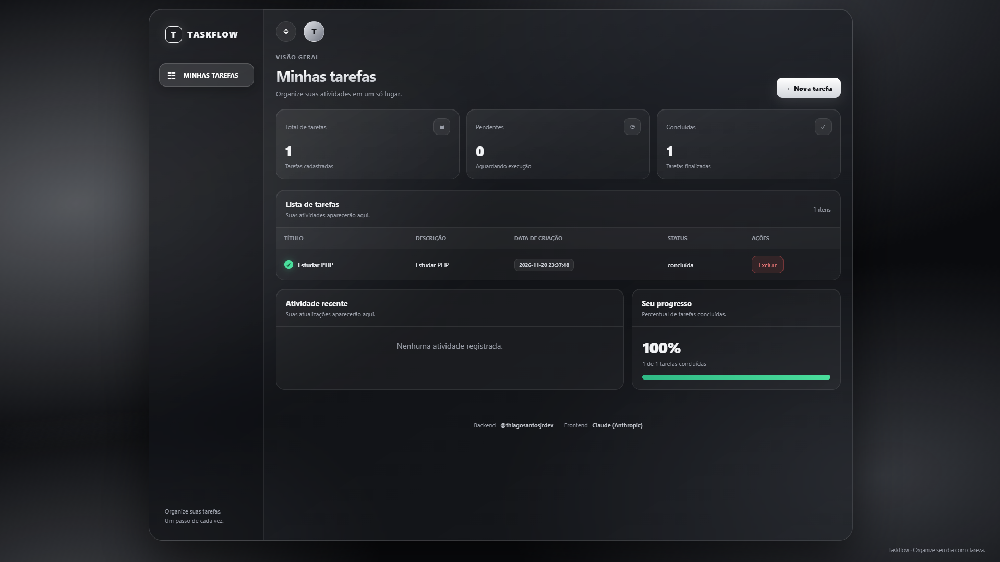

# Task Manager

[🇺🇸 English](README.md) | 🇧🇷 Português

Um gerenciador de tarefas simples, para um único usuário, feito com **PHP**, **PDO** e **MySQL**. Crie tarefas, marque como concluídas, exclua e acompanhe seu progresso em uma interface escura e totalmente responsiva, que funciona bem no computador e no celular.



## Funcionalidades

- Criar tarefas com título e descrição
- Marcar tarefas como concluídas (e desfazer)
- Excluir tarefas, com confirmação
- Painel com contadores de total, pendentes e concluídas
- Barra de progresso com o percentual de tarefas concluídas
- Mensagens de sucesso e de erro
- Layout responsivo: menu lateral no desktop; barra de navegação inferior e lista em formato de cards no celular
- Acesso ao banco com PDO e prepared statements; toda a saída é escapada em HTML

## Tecnologias

- PHP 8.1+
- MySQL / MariaDB (PDO)
- HTML, CSS e JavaScript puro (sem frameworks nem etapa de build)

## Estrutura do projeto

```
task-manager/
├── config/
│   ├── config.php        # Carrega o arquivo de configuração no formato .env
│   └── Database.php      # Conexão PDO
├── database/
│   └── schema.sql        # Script de criação do banco e da tabela
├── public/
│   ├── index.php         # Página principal e tratamento das requisições
│   ├── create.php        # create_task()
│   ├── delete.php        # delete_task()
│   ├── functions.php     # returnTasks(), searchByID(), changeStatus()
│   └── style.css
├── views/
│   ├── header.php
│   └── footer.php
├── task-manager.env.example
└── README.md
```

## Requisitos

- PHP 8.1 ou superior com a extensão `pdo_mysql`
- MySQL ou MariaDB
- Um servidor web local (Apache via XAMPP/WAMP/MAMP, por exemplo) ou o servidor embutido do PHP

## Instalação

### 1. Clone o repositório

```bash
git clone https://github.com/<seu-usuario>/task-manager.git
cd task-manager
```

### 2. Crie o banco de dados

Execute o script `database/schema.sql` pelo cliente MySQL ou pelo phpMyAdmin:

```bash
mysql -u <seu_usuario_mysql> -p < database/schema.sql
```

### 3. Crie o arquivo de configuração

As credenciais do banco são lidas de um arquivo `task-manager.env` que **não** fica no repositório. Copie o exemplo e preencha com seus dados:

```bash
cp task-manager.env.example task-manager.env
```

```ini
DB_HOST="localhost"
DB_NAME="task_manager"
DB_USER="seu_usuario_mysql"
DB_PASS="sua_senha_mysql"
```

Por padrão, o `config/config.php` procura o arquivo em:

```php
dirname(__DIR__, 6) . '/config/task-manager.env'
```

Ou seja: sobe **seis níveis de diretório** a partir da pasta `config/` do projeto e abre `config/task-manager.env` ali. Coloque o arquivo nesse local, ou altere o segundo argumento do `dirname()` (ou o caminho inteiro) para onde você preferir guardá-lo.

### 4. Execute a aplicação

**Opção A – Apache (XAMPP, WAMP, MAMP):** copie o projeto para a pasta pública do servidor (por exemplo `htdocs/`) e acesse:

```
http://localhost/task-manager/public/
```

**Opção B – Servidor embutido do PHP:**

```bash
php -S localhost:8000 -t public
```

Depois acesse `http://localhost:8000`.

## Como usar

1. Clique em **Nova tarefa** para criar uma tarefa (título e descrição).
2. Clique no círculo ao lado da tarefa para marcá-la como concluída; clique de novo para voltá-la a pendente.
3. Clique em **Excluir** para apagar uma tarefa.
4. Acompanhe os contadores e a barra de progresso na página.

## Observações

- A interface está em português do Brasil.
- Os títulos das tarefas têm no máximo 20 caracteres e devem ser únicos.
- Este projeto **não tem login nem contas de usuário**. Foi pensado para uso pessoal, por uma única pessoa; não o exponha publicamente sem adicionar autenticação.
- Nunca envie o seu `task-manager.env` para o repositório. Ele já está listado no `.gitignore`.

## Créditos

- **Backend:** [@thiagosantosjrdev](https://github.com/thiagosantosjrdev)
- **Frontend:** [Claude](https://claude.ai) (Anthropic)